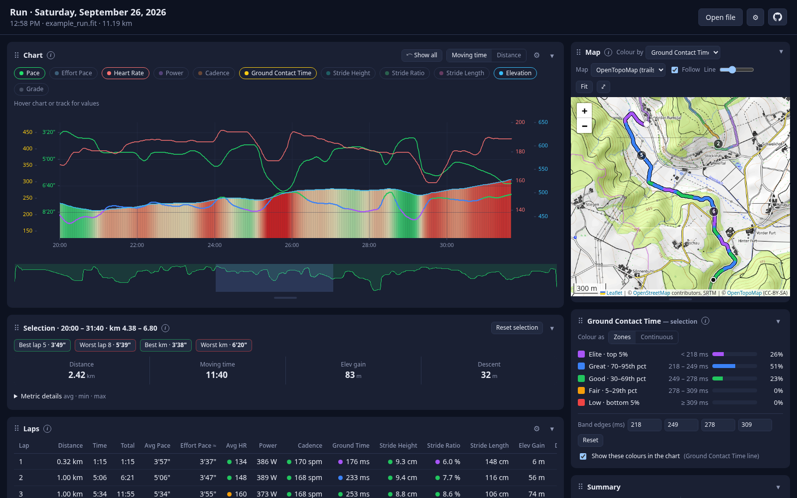
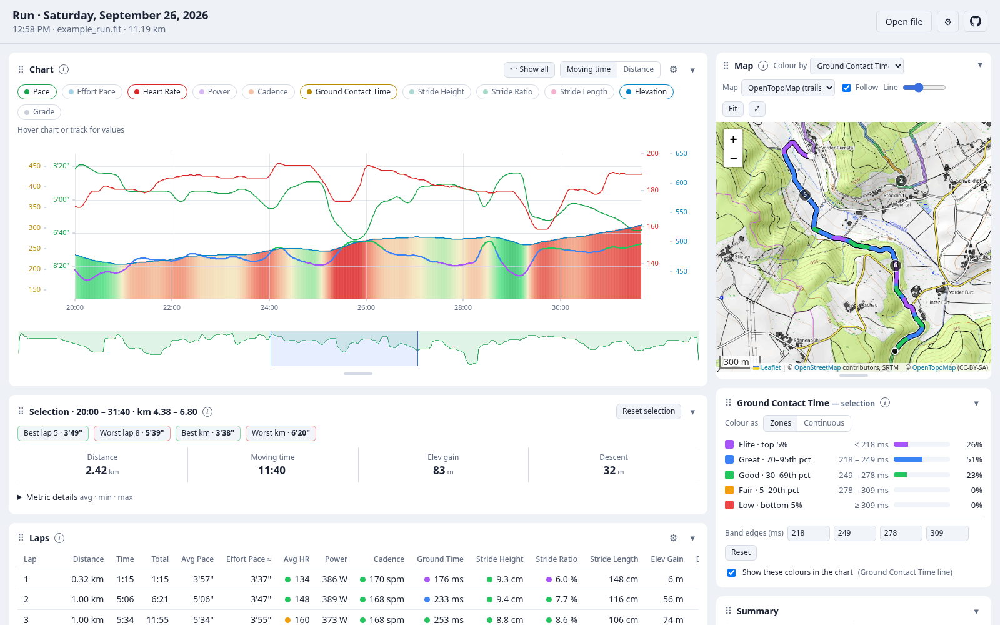

# FitFilePlus

[](https://www.buymeacoffee.com/mandula)

A single-file, offline-first viewer for running activities. Drop a `.fit` file (or `.gpx`, `.tcx`, `.kml`) onto the page and get a linked chart, map, lap table and stats view, with running-form metrics (ground contact time, cadence, stride height, …) colour-coded on the map.

Built to get what watch vendors' web views usually lack: a zoomed chart section highlighted on the map, outdoor-oriented base maps, and form metrics drawn along the track.

**▶ Open it: <https://mandulaj.github.io/FitFilePlus/>** — then drop an activity file on the page.

No install, no account, no server. To use it offline, download [`fitfileplus.html`](fitfileplus.html) and open it in a browser.

[](https://mandulaj.github.io/FitFilePlus/)

<details><summary>Light theme</summary>



</details>

## Features

- **Everything is linked.** Drag across the chart, the overview strip, lap rows, or along the track on the map: the other views, the stats and the legend follow live.
- **Colour the track by any metric**, either in reference zones or on a continuous colour scale (Plasma / Viridis). Optionally colour that metric's chart line the same way.
- **Reference zones for running form**: cadence, ground contact time, stride height (vertical oscillation), stride ratio (vertical ratio) and L/R balance use published running-dynamics reference gauges. Heart rate uses % of max HR. All band edges are editable.
- **Outdoor base maps**: OpenTopoMap, OpenStreetMap, CyclOSM, swisstopo (map and aerial), Esri satellite, optional Thunderforest Outdoors (own API key), or no base map.
- **Lap table**: sortable, column chooser, best/slowest lap marked, drag across rows to select several laps.
- **Quick selections**: best / worst lap, fastest / slowest continuous kilometre.
- **Pauses** are marked on the chart and break the track on the map.
- **Layout**: resizable columns, resizable chart and map, panels can be reordered, moved between columns and collapsed. Remembered in the browser.
- **Elevation profile coloured by gradient** (red/green, red/blue or plasma).
- **Units and themes**: metric or imperial, pace or speed (min/km, km/h, min/mi, mph); system, dark, black and light themes.
- **Hover help** on every control instead of permanent explanatory text; all settings are remembered in the browser and can be reset from the ⚙ menu.
- **Optional widgets** (＋ Widgets): scatter of any two metrics, distributions, hill profile, drift / decoupling, best efforts, climbs, and a 3D terrain map. The default panels can be hidden too; the arrangement is remembered.
- **Replay** of the track with the chart cursor following.
- **Only what the file contains is shown.** Missing metrics, laps or GPS simply hide the related controls. Distance and pace are derived from GPS when absent.

## Supported files

`.fit` is the main format: it is the only one that carries running-form metrics. Checked with files from several watch brands, platform re-exports and bare GPS tracks.

| Data | Source in the FIT file |
|---|---|
| Position, elevation, distance, speed, heart rate, cadence, power, temperature | standard `record` fields |
| Ground contact time, L/R balance, stride height, stride ratio, stride length | standard running-dynamics `record` fields |
| Effort Pace, Leg Spring Stiffness | developer fields, when the watch records them |
| Laps, totals, pauses | `lap`, `session` and gaps between records |

Beyond that list, files are scanned for further data and anything found is shown as an extra metric (chart, map colouring, stats): other standard FIT record fields such as respiration rate, core temperature, muscle oxygen, cycling dynamics or GPS accuracy; custom developer fields defined by watch apps and sensors; and extra numeric tags in GPX / TCX extensions. Fields without a documented meaning can be shown as `Field N` via the chart settings.

Other formats are read too and show whatever they contain:

| Format | Typically contains |
|---|---|
| `.fit` | everything above — the format to prefer |
| `.tcx` | position, elevation, distance, heart rate, cadence, sometimes speed and power; laps |
| `.gpx` | position, elevation, time; heart rate, cadence, power, temperature when the exporter adds extensions |
| `.kml` | track shape and elevation only, usually without timestamps (then: no pace, no durations, distance axis only) |

Running-form metrics and power from the watch are only in `.fit`.

## Reference zones

| Metric | Top 5% | 70–95th pct | 30–69th pct | 5–29th pct | Bottom 5% |
|---|---|---|---|---|---|
| Cadence (spm) | > 183 | 174–183 | 164–173 | 153–163 | < 153 |
| Ground contact time (ms) | < 218 | 218–248 | 249–277 | 278–308 | > 308 |
| Stride height (cm) | < 6.4 | 6.4–8.1 | 8.2–9.7 | 9.8–11.5 | > 11.5 |
| Stride ratio (%) | < 6.1 | 6.1–7.4 | 7.5–8.6 | 8.7–10.1 | > 10.1 |

L/R balance: 49.3–50.7 % left is balanced; beyond 52.2 % on either side is strongly one-sided.

Source: [*Color Gauges and Running Dynamics Data*](https://www8.garmin.com/manuals/webhelp/GUID-1E5740B3-60A1-4890-B39A-7587060D785A/EN-US/GUID-EE9E7F6F-49BE-4452-82E6-B40371D0AEC1.html) (chest-sensor column). These are percentiles of a runner population, not targets. Values shift with speed, and wrist-based watches may read slightly differently from a chest strap, so treat the bands as orientation.

Stride length, leg spring stiffness, pace and power have no universal reference and use a relative scale per activity.

## Privacy

- The activity file is parsed in the browser. Nothing is uploaded.
- The last opened file is kept in the browser's IndexedDB so a reload shows it again; "Close file" in the ⚙ menu removes it.
- The optional 3D map downloads its engine from a CDN (jsDelivr) and terrain tiles from AWS when it is opened; without that widget no such requests are made.
- Map tiles are fetched from the selected tile provider, which therefore sees which area you look at. Choose "No basemap" to avoid any network request.
- Settings (layout, band edges, map choice, optional Thunderforest key) are kept in the browser's `localStorage`.

## Development

```
src/index.html   page skeleton
src/style.css    styles
src/fit.js       minimal FIT decoder (no dependencies; also usable from node)
src/formats.js   GPX / TCX / KML readers producing the same structure as the FIT decoder
src/app.js       UI
src/widgets.js   optional add-on widgets (use the small API app.js exposes as window.FFP)
vendor/          Leaflet and uPlot, pinned
build.py         inlines everything into fitfileplus.html
index.html       GitHub Pages entry point, forwards to fitfileplus.html
.assets/         README screenshots
web/             favicon and link-preview image for the hosted page
.nojekyll        makes GitHub Pages serve the files as they are
```

Build (Python 3, no packages needed):

```sh
python3 build.py
```

For testing, a build with an activity baked in (loads without drag and drop):

```sh
python3 build.py --embed path/to/run.fit /tmp/test.html
```

State can be preset through the URL hash, e.g. `test.html#color=gct&layer=topo&sel=1996-2777&m=pace,hr` (`sel` is in moving seconds). `#drop=gps,power,laps` blanks fields to simulate sparse files.

Put your own activity files in `data/`; that folder is git-ignored.

## Known limitations

- Per-lap Effort Pace is approximated from the per-second values and can differ from the watch vendor's app.
- Elevation gain for a selection is computed from the recorded altitude and can differ slightly from the device total.
- Results of watch-guided running tests (threshold pace, fitness score) are not stored in the FIT file and cannot be shown.
- Dragging along the track to select is mouse-only.

## Licence

[MIT](LICENSE). Bundled libraries keep their own licences, see [`vendor/LICENSES.md`](vendor/LICENSES.md).

## Credits

- [Leaflet](https://leafletjs.com) (BSD-2-Clause) for the map
- [uPlot](https://github.com/leeoniya/uPlot) (MIT) for the chart
- [MapLibre GL JS](https://maplibre.org) (BSD-3-Clause) for the optional 3D map; not bundled, loaded from a CDN when that widget is used. Terrain tiles: Mapzen / AWS Open Data.
- Map data © [OpenStreetMap](https://www.openstreetmap.org/copyright) contributors; tiles by OpenTopoMap, CyclOSM, swisstopo, Esri

Not affiliated with any watch or platform vendor.
